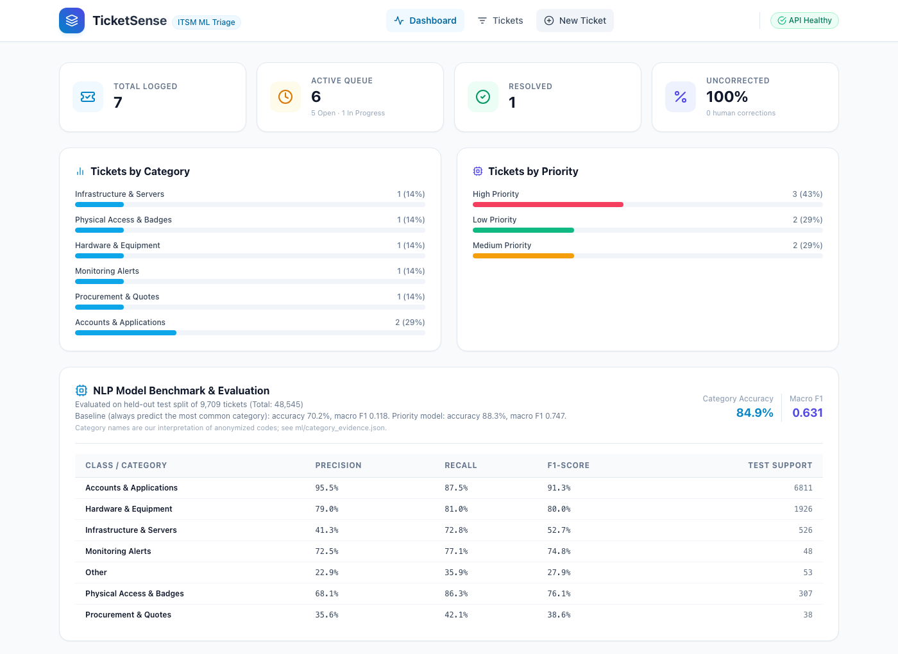
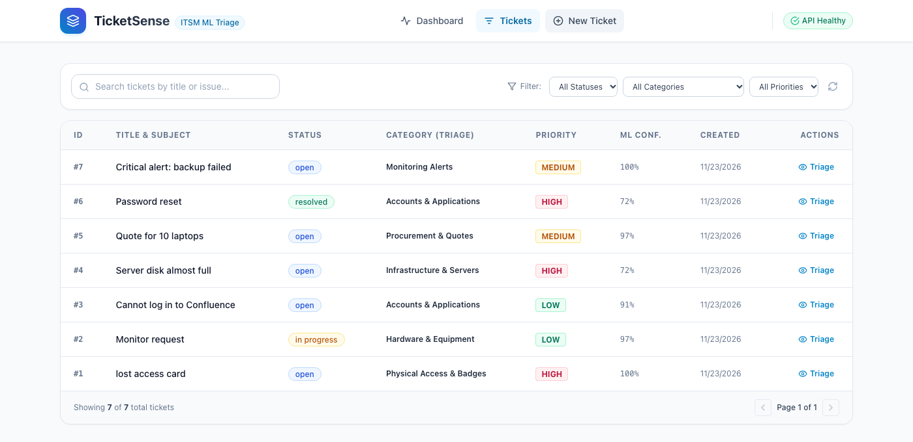
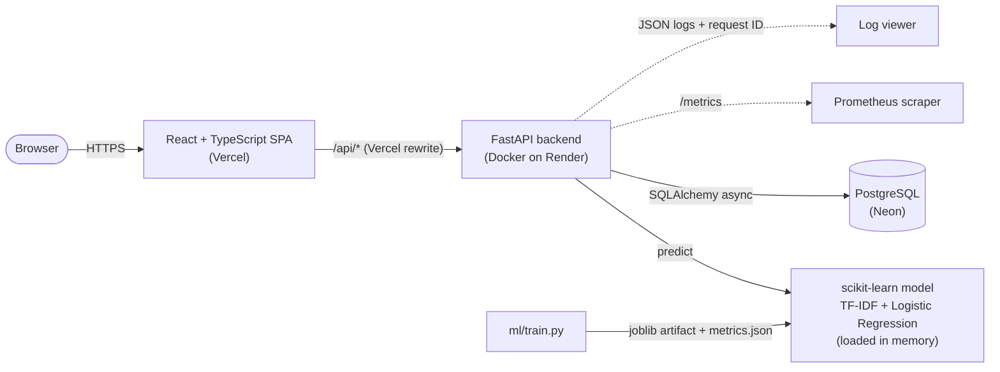

# TicketSense

[](https://github.com/VydyaP/ticketsense/actions/workflows/ci.yml)
[](LICENSE)

**An IT help-desk app that reads each new support ticket and predicts its category and priority with a machine-learning model served by a FastAPI backend.**

**Live demo:** [ticketsense-opal.vercel.app](https://ticketsense-opal.vercel.app) · **API docs:** [Swagger /docs](https://ticketsense-api-nq5s.onrender.com/docs) · **Health:** [/health](https://ticketsense-api-nq5s.onrender.com/health)

> Hosted on free tiers: if the API has been idle, the first request takes up to a minute while the server wakes up.



## Features

- **Submit a ticket** → the API predicts **category** (7 classes) and **priority** (High / Medium / Low) with confidence scores, and stores both in PostgreSQL.
- **Live preview**: the form shows the prediction while you type (`POST /api/predict`, nothing saved).
- **Ticket queue**: search, filter by status / category / priority, paginate, update status.
- **Human feedback**: agents correct a wrong category; the correction is stored next to the original prediction as labelled data for retraining.
- **Dashboard**: counts by category, priority and status, plus the model's real test-set metrics.
- **Monitoring**: `/health` (DB + model readiness), `/metrics` (Prometheus), JSON logs with a request ID on every line.
- **Engineering**: 17 backend tests against real PostgreSQL, 6 frontend tests, lint + format checks, Docker, CI on every push.



## Architecture



In production the browser only talks to the Vercel domain; Vercel forwards `/api/*` and `/health` to Render (see `frontend/vercel.json`), so no CORS setup is needed. On startup the container runs `alembic upgrade head` and only then starts the API (a failed migration stops the deploy). Details and trade-offs are in [docs/DESIGN.md](docs/DESIGN.md).

## Tech stack

| Layer | Tools |
| --- | --- |
| Backend | Python 3.11, FastAPI, Pydantic v2, SQLAlchemy 2 (async, asyncpg), Alembic |
| Database | PostgreSQL 16 (Neon in production) |
| ML | scikit-learn, pandas, joblib |
| Frontend | React 18, TypeScript, Vite, Tailwind CSS |
| Tests & quality | pytest, Vitest + Testing Library, ruff, ESLint, Prettier, pre-commit (incl. gitleaks) |
| Ops | Docker, docker compose, GitHub Actions, Prometheus client, structured JSON logging |
| Hosting | Render (API), Neon (Postgres), Vercel (frontend) |

## Model results

Every number below comes from `python ml/train.py` and is stored in [`ml/metrics.json`](ml/metrics.json). Test set: **9,709 tickets** (a stratified 20% hold-out of 48,545; seed 42).

| Model | Accuracy | Macro F1 | Weighted F1 | Majority-class baseline (acc / macro F1) |
| --- | --- | --- | --- | --- |
| Category (7 classes) | **84.9%** | **0.631** | 0.859 | 70.2% / 0.118 |
| Priority (3 classes) | **88.3%** | **0.747** | 0.884 | 71.0% / 0.277 |

Category model, per class (test set):

| Category | Precision | Recall | F1 | Test tickets |
| --- | --- | --- | --- | --- |
| Accounts & Applications | 0.955 | 0.875 | 0.913 | 6,811 |
| Hardware & Equipment | 0.790 | 0.811 | 0.800 | 1,926 |
| Physical Access & Badges | 0.681 | 0.863 | 0.762 | 307 |
| Monitoring Alerts | 0.726 | 0.771 | 0.748 | 48 |
| Infrastructure & Servers | 0.413 | 0.728 | 0.527 | 526 |
| Procurement & Quotes | 0.356 | 0.421 | 0.386 | 38 |
| Other | 0.229 | 0.359 | 0.279 | 53 |

**How to read this:** accuracy looks high partly because one class is 70% of the data, which is why macro F1 (every class weighted equally) is the headline number. The model is strong on large, distinctive classes and weak on small ones. "Procurement & Quotes" is often predicted as "Hardware & Equipment", because purchase requests for equipment appear in both. See the [confusion matrix](ml/confusion_matrix.png).

Inference speed (measured on an Apple M3): `model.predict` p50 **0.5 ms**; `POST /api/predict` through the Docker container p50 **1.7 ms**, p95 2.4 ms (localhost, 300 requests).

## Data

- **Dataset:** Endava IT support tickets: 48,549 real help-desk emails, released in anonymized form by Microsoft and Endava in [karolzak/support-tickets-classification](https://github.com/karolzak/support-tickets-classification) (MIT license).
- **Download:** the official link in that repo expired in 2022. `ml/train.py` downloads an identical public mirror ([vanessaaleung/support-ticket-nlp](https://github.com/vanessaaleung/support-ticket-nlp)) and **verifies its SHA-256 checksum**, so every run uses exactly the same file. The raw CSV is not committed.
- **Preprocessing:** title and body joined; tickets shorter than 8 characters dropped (4 removed → 48,545).

### Important: the category names are my interpretation

The published data is anonymized: `category` is just an integer from 0 to 12, and the original names were never released. I named the codes by reading sample tickets and the top TF-IDF terms of each code. Codes with mixed content or too few examples were grouped as **Other**. The evidence is regenerated on every training run in [`ml/category_evidence.json`](ml/category_evidence.json):

| Code | Tickets | Top terms | Mapped to |
| --- | --- | --- | --- |
| 4 | 34,058 | access, error, (generic email words) | Accounts & Applications* |
| 5 | 9,633 | po, purchase, monitor, laptop | Hardware & Equipment |
| 6 | 2,628 | server, engineer, access, connection | Infrastructure & Servers |
| 7 | 921 | card, access, starter, enabling, area | Physical Access & Badges |
| 11 | 612 | card, lost, access, badge, door | Physical Access & Badges |
| 8 | 239 | alert, critical, tape, recovery | Monitoring Alerts |
| 9 | 191 | purchase, quote, equipment, request | Procurement & Quotes |
| 0, 1, 2, 3, 10, 12 | 263 | mixed (passwords, PC swaps, capacity reports) | Other |

\*Code 4 is the largest and most generic class; its name comes from reading samples (access requests, password and application issues, joiners/leavers).

**Priority** comes from the anonymized `urgency` field (0–3), mapped to 0–1 → High, 2 → Medium, 3 → Low. This assumes lower code = more urgent (the usual ITIL convention). Supporting evidence: code 3 holds 71% of tickets, and words like "urgent/asap/critical" are about twice as frequent in codes 0–2. It is still an assumption, not documented ground truth.

## Run locally

Requirements: Docker Desktop.

```bash
git clone https://github.com/VydyaP/ticketsense.git
cd ticketsense
docker compose up --build
```

- App: http://localhost:5173
- API docs (Swagger): http://localhost:8000/docs
- Health: http://localhost:8000/health · Metrics: http://localhost:8000/metrics

<details>
<summary>Without Docker for the API (faster reloads)</summary>

```bash
python -m venv .venv
source .venv/bin/activate          # Windows: .venv\Scripts\activate
pip install -r backend/requirements-dev.txt
cp .env.example .env               # Windows: copy .env.example .env
docker compose up -d postgres      # or any local PostgreSQL
alembic upgrade head
uvicorn backend.app.main:app --reload

cd frontend && npm install && npm run dev   # proxies /api to :8000
```
</details>

### Retrain the model

```bash
python ml/train.py   # downloads + verifies data, trains, writes metrics.json, confusion matrix, artifact
```

## Tests

```bash
# Backend: needs a throwaway Postgres (tests drop and recreate its tables)
docker run -d --name ticketsense-testdb -e POSTGRES_PASSWORD=postgres \
  -e POSTGRES_DB=ticketsense_test -p 5432:5432 postgres:16-alpine
pytest                       # runs Alembic migrations, then API + model tests
ruff check . && ruff format --check .

# Frontend
cd frontend
npm test && npm run lint && npm run format:check && npm run build
```

CI ([`.github/workflows/ci.yml`](.github/workflows/ci.yml)) runs all of the above on every push and pull request, with Postgres as a service container. It then builds the Docker image and smoke-tests it: the container must migrate a fresh database and return a healthy `/health`.

## API

| Method | Path | Purpose | Codes |
| --- | --- | --- | --- |
| POST | `/api/tickets` | Create ticket + predict + save | 201, 422, 503 |
| GET | `/api/tickets` | List; filters `status`, `category`, `priority`, `search`; `page`, `page_size` | 200, 422 |
| GET | `/api/tickets/{id}` | One ticket incl. full probability distribution | 200, 404 |
| PATCH | `/api/tickets/{id}` | Update `status` and/or `corrected_category` (must be a known category) | 200, 404, 422 |
| POST | `/api/predict` | Predict without saving | 200, 422, 503 |
| GET | `/api/stats` | Counts by status, category, priority; corrections | 200 |
| GET | `/api/model/metrics` | Test-set metrics from training | 200, 503 |
| GET | `/health` | DB connectivity + model loaded | 200, 503 |
| GET | `/metrics` | Prometheus: request count & latency by route, predictions by category | 200 |

Full interactive docs at `/docs`.

## Project structure

```
ticketsense/
├── backend/
│   ├── app/
│   │   ├── api/          # routers: tickets, predict, stats, health/metrics
│   │   ├── core/         # config (env vars), database, JSON logging, Prometheus
│   │   ├── ml/           # model loading + prediction; artifacts/ holds the trained model
│   │   ├── models/       # SQLAlchemy Ticket table
│   │   ├── schemas/      # Pydantic request/response models (validation)
│   │   ├── services/     # ticket business logic and stats queries
│   │   └── main.py       # app, middleware, error handlers
│   ├── migrations/       # Alembic
│   ├── tests/            # pytest (real Postgres)
│   ├── Dockerfile
│   └── entrypoint.sh     # migrate, then start uvicorn
├── frontend/src/         # components, hooks, typed API client, Vitest tests
├── ml/                   # train.py, metrics.json, confusion_matrix.png, category_evidence.json
├── docs/                 # DESIGN.md, screenshots
├── docker-compose.yml
└── .github/workflows/ci.yml
```

## What I would improve next

1. **Retrain from feedback:** export human corrections from the database, add them to the training set, and retrain only if macro F1 on the fixed test set improves (with the old model kept for rollback).
2. **Better small-class performance:** try sentence embeddings (e.g. a small MiniLM model) + Logistic Regression and compare macro F1 against the latency and memory cost, since "Other" and "Procurement" are the weak spots.
3. **Production hardening:** authentication with agent vs. requester roles, rate limiting on `/api/predict`, and alerting on `/health` and error-rate metrics.

## License

Code: [MIT](LICENSE). Dataset: see [Data](#data) above.
