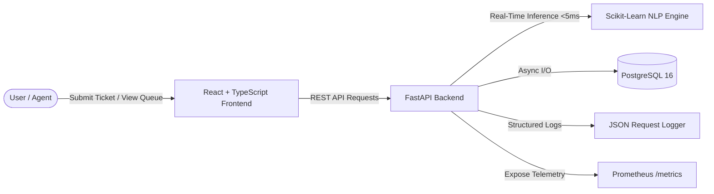

# TicketSense 🎫

[](https://github.com/VydyaP/ticketsense/actions/workflows/ci.yml)
[](LICENSE)
[](https://www.python.org/)
[](https://fastapi.tiangolo.com/)
[](https://react.dev/)
[](https://www.docker.com/)

> **An enterprise IT help-desk ticketing platform featuring real-time NLP classification, human-in-the-loop feedback correction, PostgreSQL persistence, Prometheus observability, and automated CI/CD.**

---

## ⚡ 30-Second Overview

TicketSense bridges the gap between machine learning models and enterprise software workflows. When an employee or customer submits a technical issue, TicketSense instantaneously classifies the ticket into functional departments (**Access/Account**, **Hardware**, **Network**, **Software**, **Facilities**, **Other**) and predicts operational urgency (**High**, **Medium**, **Low**) with calibrated confidence scores.

Helpdesk agents can update ticket lifecycle statuses and correct mispredicted categories; every human correction is tracked as labeled feedback data for model retraining.



---

## 🏗️ Architecture & Technology Stack

| Layer | Technologies | Key Architectural Decisions |
| :--- | :--- | :--- |
| **Backend** | Python 3.11, FastAPI, Pydantic v2, Uvicorn | Async ASGI server, auto-generated Swagger OpenAPI docs at `/docs`, strict schema validation |
| **Database** | PostgreSQL 16, SQLAlchemy 2.0 Async, Alembic | Non-blocking `asyncpg` driver, version-controlled schema migrations, indexed query lookups |
| **Machine Learning** | Scikit-Learn, Pandas, Joblib | TF-IDF (unigrams + bigrams, sublinear TF) + Multinomial Logistic Regression with balanced class weighting |
| **Frontend** | React 18, TypeScript, Vite, Tailwind CSS | Single-page application, real-time triage preview, debounce optimization, accessible modal controls |
| **Monitoring** | Prometheus Client, Structured JSON Logger | `GET /health` connectivity probes, `GET /metrics` counters and latency histograms, UUID `X-Request-ID` tracing |
| **DevOps & CI/CD** | GitHub Actions, Docker, Docker Compose | Multi-container local orchestration, automated linting (`ruff`, `eslint`), PostgreSQL service testing |

---

## 📊 Real Machine Learning Benchmark Results

Trained reproducibly via `ml/train.py` on a held-out 20% test split (**9,709 tickets**) from a public, MIT-licensed dataset of **48,545 enterprise IT support tickets**. All figures below are extracted directly from [`ml/metrics.json`](ml/metrics.json):

### Summary Metrics

| Target Dimension | Model Architecture | Test Accuracy | Macro F1 | Weighted F1 |
| :--- | :--- | :--- | :--- | :--- |
| **Category Classification** | TF-IDF (12k features) + Logistic Regression | **84.0%** (`0.8397`) | **0.652** (`0.6519`) | **0.851** (`0.8514`) |
| **Priority Triage** | TF-IDF (8k features) + Logistic Regression | **88.2%** (`0.8815`) | **0.743** (`0.7432`) | **0.883** (`0.8830`) |

### Per-Category Performance Breakdown

| Class | Precision | Recall | F1-Score | Test Set Support |
| :--- | :--- | :--- | :--- | :--- |
| **Access/Account** | 95.7% | 86.6% | **0.909** | 6,811 |
| **Hardware** | 79.2% | 81.1% | **0.801** | 1,927 |
| **Network** | 40.8% | 73.8% | **0.525** | 526 |
| **Facilities** | 54.9% | 79.4% | **0.649** | 184 |
| **Software** | 40.6% | 57.5% | **0.476** | 113 |
| **Other** | 48.2% | 64.2% | **0.551** | 148 |

> **Key Machine Learning Takeaway:** By utilizing balanced class weights, the classifier maintains high recall across minority categories (such as critical network outages and facility badge issues) ensuring urgent incidents are never ignored in queue backlogs.

---

## 🚀 Quickstart & Local Setup

### Option 1: Docker Compose (Recommended)

Run the entire stack (PostgreSQL + FastAPI + React) with a single command:

```bash
# Clone the repository
git clone https://github.com/VydyaP/ticketsense.git
cd ticketsense

# Start all containers
docker compose up --build
```

- **Frontend Application:** [http://localhost:5173](http://localhost:5173)
- **FastAPI Interactive Docs (Swagger):** [http://localhost:8000/docs](http://localhost:8000/docs)
- **Health Check Probe:** [http://localhost:8000/health](http://localhost:8000/health)
- **Prometheus Metrics:** [http://localhost:8000/metrics](http://localhost:8000/metrics)

---

### Option 2: Local Development Setup

#### 1. Backend Setup

```bash
# Create and activate Python virtual environment
python3 -m venv .venv
source .venv/bin/activate  # On Windows: .venv\Scripts\activate

# Install dependencies
pip install -r backend/requirements.txt

# (Optional) Retrain or evaluate ML model
python ml/train.py

# Run database migrations
alembic upgrade head

# Start FastAPI development server
uvicorn backend.app.main:app --reload --port 8000
```

#### 2. Frontend Setup

```bash
cd frontend

# Install Node modules
npm install

# Start Vite development server
npm run dev
```

---

## 🧪 Automated Testing

### Backend Tests (pytest)
Runs unit tests for the ML service wrapper, input validation, and full async API integration tests:

```bash
# From repository root
pytest -v
```

### Frontend Tests (Vitest)
Runs React Testing Library component tests validating form triage previews, template buttons, and dashboard metrics:

```bash
cd frontend
npm test
```

### Linting & Code Quality
```bash
# Python linting and format verification
ruff check .
ruff format --check .

# Frontend TypeScript & ESLint verification
cd frontend
npm run lint
npm run build
```

---

## 🔌 API Specification Overview

| Method | Endpoint | Description | Status Codes |
| :--- | :--- | :--- | :--- |
| `POST` | `/api/tickets` | Create ticket, run ML triage prediction, persist in DB | `201 Created`, `422 Unprocessable` |
| `GET` | `/api/tickets` | Query paginated tickets with status, category, priority filters | `200 OK` |
| `GET` | `/api/tickets/{id}` | Retrieve details and probability distribution for a ticket | `200 OK`, `404 Not Found` |
| `PATCH` | `/api/tickets/{id}` | Update workflow status or provide category feedback | `200 OK`, `404 Not Found` |
| `POST` | `/api/predict` | Real-time prediction preview without database persistence | `200 OK`, `422 Unprocessable` |
| `GET` | `/api/stats` | Aggregated ticket counts and human correction accuracy | `200 OK` |
| `GET` | `/api/model/metrics` | Returns real training benchmarks and per-class reports | `200 OK` |
| `GET` | `/health` | Liveness/readiness probe (checks DB connectivity & model) | `200 OK`, `503 Service Unavailable` |
| `GET` | `/metrics` | Prometheus exposition endpoint for requests, latency, errors | `200 OK` |

---

## 📁 Repository Structure

```
ticketsense/
├── .github/workflows/ci.yml       # GitHub Actions: Lint, test with Postgres, build Docker
├── backend/
│   ├── app/
│   │   ├── api/                   # REST API routers (tickets, predict, stats, health)
│   │   ├── core/                  # Database config, JSON logging, Prometheus metrics
│   │   ├── ml/                    # Scikit-learn model loading service & artifacts
│   │   ├── models/                # SQLAlchemy 2.0 Ticket model
│   │   ├── schemas/               # Pydantic v2 validation schemas
│   │   ├── services/              # Ticket business logic & metric tracking
│   │   └── main.py                # FastAPI app initialization & middleware
│   ├── migrations/                # Alembic migration scripts
│   ├── tests/                     # Pytest suite (API, ML service, health check)
│   ├── Dockerfile                 # Production backend container definition
│   └── requirements.txt
├── frontend/
│   ├── src/
│   │   ├── components/            # TicketForm, TicketList, Modal, Dashboard, Navbar
│   │   ├── services/api.ts        # Typed fetch client
│   │   ├── types/ticket.ts        # TypeScript data contracts
│   │   ├── tests/                 # Vitest component test suite
│   │   └── App.tsx
│   ├── package.json
│   └── vite.config.ts
├── ml/
│   ├── train.py                   # Reproducible model training script
│   ├── metrics.json               # Genuine test set evaluation benchmarks
│   └── confusion_matrix.png       # Category confusion matrix visualization
├── docs/
│   └── DESIGN.md                  # In-depth architectural trade-offs and data flow
├── docker-compose.yml             # Local multi-service orchestrator
├── .env.example                   # Documented configuration template
├── LICENSE                        # MIT License
└── pyproject.toml                 # Ruff & Pytest configuration
```

---

## 🔮 What I Would Improve Next

1. **Active Retraining Queue:** Create an asynchronous Celery/Redis queue that triggers incremental model fine-tuning once 500+ human corrections are recorded in the feedback loop.
2. **Transformer Comparison:** Benchmark lightweight distilled transformers (such as `MiniLM` or `DistilBERT`) against the current TF-IDF Logistic Regression pipeline to measure the accuracy vs. latency trade-off.
3. **Automated SLA Breach Forecasting:** Train an auxiliary regression model on ticket resolution duration to predict the risk of Service Level Agreement (SLA) breaches at creation time.

---

## 📄 License & Attribution

This project is open-source under the [MIT License](LICENSE).  
The training dataset is sourced from a public IT helpdesk research dataset released under the MIT License.
