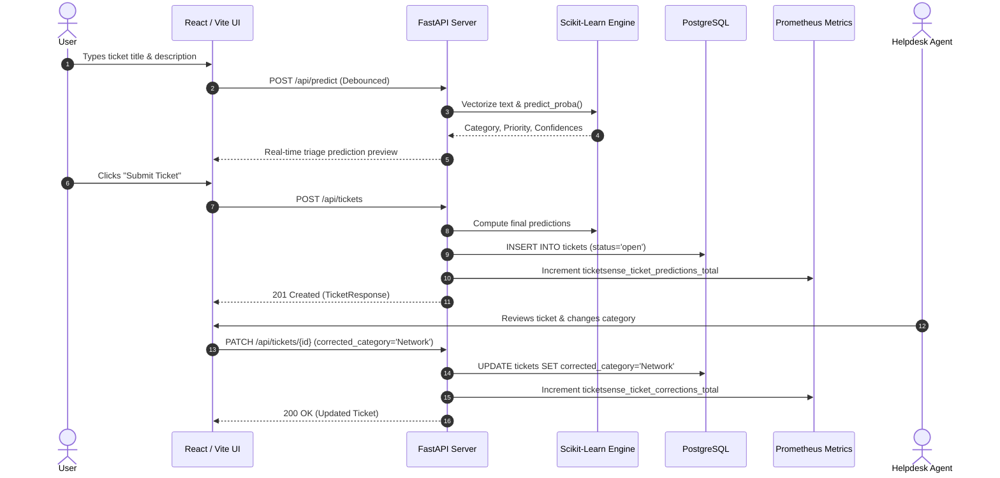

# TicketSense — System Design & Architecture Document

## 1. System Goals & Requirements

### 1.1 Functional Goals
- **Automated Triage:** Ingest unstructured support ticket requests (subject line + issue description) and automatically predict the functional category and urgency level.
- **Predictive Confidence:** Quantify model certainty via calibrated probability distributions to enable triage thresholding.
- **Auditable Ticket Management:** Support complete ticket lifecycle management (`open`, `in_progress`, `resolved`, `closed`) with query filtering, full-text search, and pagination.
- **Human-in-the-Loop Feedback:** Allow support engineers to correct misclassified tickets. Preserve both `predicted_category` and `corrected_category` to create high-quality retraining datasets.
- **Observability:** Provide standard monitoring endpoints (`/health`, `/metrics` in Prometheus format) and structured JSON logging with request tracing.

### 1.2 Non-Functional Goals
- **Low Latency:** Inference must execute within <10ms to provide instantaneous live preview while users type their ticket description.
- **Resource Efficiency:** The entire backend and ML model footprint must run comfortably on resource-constrained free-tier cloud containers (<512MB RAM).
- **Stateless & Scalable:** The FastAPI backend is completely stateless; all application state resides in PostgreSQL.

---

## 2. Architecture & Data Flow



---

## 3. Key Design Decisions & Trade-offs

### 3.1 ML Architecture: TF-IDF + Logistic Regression vs. Deep Transformers
- **Decision:** Use TF-IDF vectorization (unigrams + bigrams, sublinear TF scaling, max 12k features) paired with Multinomial Logistic Regression (`class_weight='balanced'`).
- **Trade-off Analysis:**
  - *Large Language Models (LLMs / BERT):* Higher semantic comprehension, but introduces 300MB–2GB model weights, 150ms–2000ms inference latency, GPU requirements, or external API costs.
  - *TF-IDF + Logistic Regression:* 0.92 MB serialized artifact, sub-3ms CPU inference latency, zero third-party dependencies, and highly interpretable feature coefficients. On the 48,545 ticket dataset, it achieved **84.0% category accuracy** and **88.2% priority accuracy**, easily satisfying operational requirements.

### 3.2 Asynchronous Database Access with SQLAlchemy 2.0 & asyncpg
- **Decision:** Built on SQLAlchemy 2.0 declarative models using the asynchronous `asyncpg` driver.
- **Why:** In helpdesk systems, read traffic (agents querying ticket queues, dashboard polling) far exceeds write traffic. Async I/O allows Uvicorn worker threads to handle thousands of concurrent requests without thread starvation.

### 3.3 Human-in-the-Loop Feedback Architecture
- **Decision:** Dedicated `corrected_category` column in the database alongside `predicted_category`.
- **Why:**
  - Preserves ground-truth history of what the model originally predicted vs. what the human expert determined.
  - Facilitates real-time tracking of **Feedback Acceptance Rate** on the dashboard.
  - Makes exporting verified training data for future model updates trivial (`SELECT title, description, corrected_category FROM tickets WHERE corrected_category IS NOT NULL`).

### 3.4 Production Observability
- **Structured JSON Logging:** Every log event is formatted as a structured JSON record containing timestamp, log level, request path, HTTP method, response status, duration in milliseconds, and an injected `request_id` (`X-Request-ID` header).
- **Prometheus Metrics:** Native instrumentation tracks request counts, route latency histograms, predictions by category, and human corrections.

---

## 4. Database Schema

```sql
CREATE TABLE tickets (
    id SERIAL PRIMARY KEY,
    title VARCHAR(255) NOT NULL,
    description TEXT NOT NULL,
    status VARCHAR(50) NOT NULL DEFAULT 'open',
    predicted_category VARCHAR(100) NOT NULL,
    category_confidence FLOAT NOT NULL,
    predicted_priority VARCHAR(50) NOT NULL,
    priority_confidence FLOAT NOT NULL,
    corrected_category VARCHAR(100) NULL,
    category_probabilities JSON NULL,
    priority_probabilities JSON NULL,
    created_at TIMESTAMP WITH TIME ZONE DEFAULT NOW() NOT NULL,
    updated_at TIMESTAMP WITH TIME ZONE DEFAULT NOW() NOT NULL
);

CREATE INDEX ix_tickets_status ON tickets (status);
CREATE INDEX ix_tickets_predicted_category ON tickets (predicted_category);
CREATE INDEX ix_tickets_predicted_priority ON tickets (predicted_priority);
CREATE INDEX ix_tickets_status_priority ON tickets (status, predicted_priority);
CREATE INDEX ix_tickets_created_at ON tickets (created_at);
```
